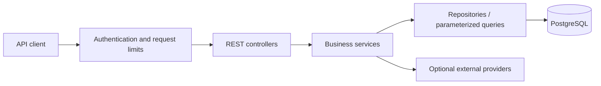

# Sana Backend — Code Showcase

Sana is a Java and Spring Boot backend for managing a merchant's inventory, sales,
invoices, and customer payments. It also supports optional AI integrations that turn
text or audio into inventory commands for a user to review and confirm.

> **This is a curated showcase of the original private Sana project.** It is a separate
> repository prepared for portfolio review, with a fresh Git history and changes to
> configuration, security, and dependencies. The original development repository remains
> private. This copy does not represent its full development history or its deployment
> environment, and it contains no production credentials or customer database.

The purpose of this repository is to make the backend's design, business logic, and tests
available for technical review. There is no hosted demo; you can explore the code without
configuring any external services.

## Project overview

The backend models the everyday work of a merchant: keeping stock across locations,
recording sales, issuing invoices, and tracking customer payments. AI assists with command
entry; the application validates commands and applies business rules before changing data.

| Area | Implementation |
| --- | --- |
| Inventory | Products, stock additions, sales, transfers, updates, soft deletion, and product suggestions |
| Invoices | ADD/SELL snapshots, customer assignment, and reversal using stored stock deltas |
| Customer payments | Payment ledger, balance summaries, idempotent requests, and payment reversals |
| Reporting | Paginated operational history and structured inventory and sales analytics |
| Authentication | Email/phone registration, Argon2id password hashing, and expiring opaque tokens |
| Optional integrations | DeepSeek/OpenAI command parsing, ElevenLabs transcription, and WalletWallet passes |

**Stack:** Java 17 · Spring Boot 4 · Spring Data JPA · PostgreSQL · Flyway · Maven ·
JUnit · Testcontainers · GitHub Actions

## Where to start reviewing

These parts show the main engineering decisions:

- [Inventory operations](src/main/java/com/is/aigul/service/ActionService.java) and
  [invoice handling](src/main/java/com/is/aigul/service/InvoiceService.java): transactional
  stock changes, invoice snapshots, and ownership checks. Undo uses the stored invoice
  rather than quantities submitted by the client.
- [Customer payment service](src/main/java/com/is/aigul/service/CustomerPaymentService.java):
  payment recording, idempotency, reversals, and balance calculations.
- [Command validation](src/main/java/com/is/aigul/service/CommandValidator.java) and
  [preprocessing](src/main/java/com/is/aigul/service/CommandPreprocessorService.java):
  validation of client/model input and resolution of inventory command cards.
- [API authentication filter](src/main/java/com/is/aigul/config/ApiAuthenticationFilter.java):
  authentication required by default, authentication rate limits, and bounded request bodies.
- [PostgreSQL undo tests](src/test/java/com/is/aigul/service/PostgresUndoIntegrationTest.java),
  [payment persistence tests](src/test/java/com/is/aigul/service/CustomerPaymentPersistenceIntegrationTest.java),
  and [migration tests](src/test/java/com/is/aigul/migration/FlywayMigrationTest.java):
  checks for concurrency, persistence behavior, and schema evolution.

Additional API documentation covers [customer payments](docs/customer-payments-api.md)
and [product suggestions](docs/product-autocomplete.md).

## Architecture



Controllers handle HTTP requests, services enforce business rules and ownership, and
repositories handle persistence. Transactions coordinate stock, invoice, and payment
changes. Flyway migrations version the database schema.

For AI-assisted entry, the flow is **text/audio → parsed command card → validation and
preprocessing → user confirmation → inventory operation**. External providers do not
execute SQL or directly modify the database.

## How this showcase differs from the original

This copy was prepared specifically for code review:

- It starts with a fresh commit history; the original project's commits are not included.
- Provider credentials are supplied through environment variables. Local secrets, customer
  data, and production deployment configuration are excluded.
- Dependencies were updated and security checks were added to CI.
- Authentication, request limits, error responses, and ownership checks were hardened.
- Model-generated SQL execution was removed. Inventory `GET` commands return
  `400 UNSUPPORTED_OPERATION`; reading data uses the structured APIs.
- ADD/SELL undo requires an owned, active invoice and uses its stored stock deltas.
  MOVE undo is unavailable in this copy.

These choices make the source suitable for sharing and inspection. They do not imply that
this repository is identical to the original application or ready for a production rollout.

## Tests and automated checks

The test suite covers API contracts, tenant isolation, authentication, input validation,
rate limits, financial operations, invoice reversal concurrency, and database migrations.

At the initial showcase verification, **223 tests passed in GitHub CI with no failures or
skips**. Check the [Actions page](https://github.com/stallbek/sana-backend/actions) for the
current results.

- [CI](.github/workflows/ci.yml) runs Maven verification and requires the PostgreSQL
  migration and undo tests to execute.
- [Security checks](.github/workflows/security.yml) scan the source and Git history with
  Gitleaks, check the dependency inventory with OSV-Scanner, and run CodeQL analysis with
  a gate for high/critical findings.
- [Dependabot](.github/dependabot.yml) proposes dependency and workflow updates.

To run the tests locally:

```bash
./mvnw clean verify
```

Java 17 is required. Docker is required for the PostgreSQL integration tests; those tests
are skipped locally when Docker is unavailable. Tests use isolated fixtures and do not
require a customer database or paid provider credentials.

<details>
<summary>Reproduce the secret and dependency scans</summary>

The installer downloads pinned scanner binaries and verifies their SHA-256 checksums.

```bash
python3 scripts/install-security-tools.py
.tools/gitleaks dir . --redact --no-banner
.tools/gitleaks git . --redact --no-banner --log-opts='--all'
./mvnw org.cyclonedx:cyclonedx-maven-plugin:2.9.1:makeAggregateBom -DoutputName=bom.cdx
.tools/osv-scanner scan source --lockfile=target/bom.cdx.json
```

</details>

## Optional local exploration

Running the application is optional. To explore the API locally, use Java 17 and an empty
PostgreSQL 16 database named `sana` with a local user that can access it.

Copy [.env.example](.env.example) to `.env`, replace the database credentials, and export
the variables in your shell. Spring Boot does not automatically load `.env`.

```bash
cp .env.example .env
# Edit .env with your local database credentials before continuing.
set -a
source .env
set +a
./mvnw spring-boot:run
```

Flyway initializes the local database and Hibernate validates the schema. The API listens
on `http://localhost:8080`. Optional provider keys can stay blank; unconfigured integrations
return `503`. Core inventory, customer, payment, history, and analytics APIs work without
paid integrations.

Browser access from another origin requires an explicit `CORS_ALLOWED_ORIGINS` value,
such as `http://localhost:3000`.

<details>
<summary>Try a synthetic inventory request</summary>

Register a local test account using a made-up address and a password used only for testing:

```bash
curl -X POST http://localhost:8080/api/auth/register \
  -H 'Content-Type: application/json' \
  -d '{"identifier":"demo@example.test","password":"local-demo-password"}'
```

Set `SANA_TOKEN` locally to the returned token, then create a location and a product:

```bash
curl -X POST http://localhost:8080/api/locations \
  -H "token: ${SANA_TOKEN}" --data-urlencode 'name=Demo shop'

curl -X POST http://localhost:8080/api/inventory/command \
  -H "token: ${SANA_TOKEN}" -H 'Content-Type: application/json' \
  -d '{"operation":"CREATE","productName":"Demo notebook","location":"Demo shop","quantity":10,"originalPrice":25}'

curl http://localhost:8080/api/products -H "token: ${SANA_TOKEN}"
```

Tokens are accepted only through the `token` request header. They expire after 24 hours;
`/api/auth/logout` revokes them immediately.

</details>

## Scope and limitations

Sessions, rate limits, and command memory are stored in one process. Restarting it clears
sessions, and horizontal scaling would require shared state. Production operation would
also require deployment-specific work such as HTTPS, monitoring, database privileges,
and managed secrets.

The showcase uses the Spring Boot 4.0 maintenance line with explicit Tomcat and Jackson
security patch overrides. Automated scans help identify known issues; they do not establish
that software has no vulnerabilities.

## License and contributions

Released under the [MIT License](LICENSE). See [contributing](CONTRIBUTING.md) for development
guidance and [security reporting](SECURITY.md) for reporting a suspected vulnerability.
