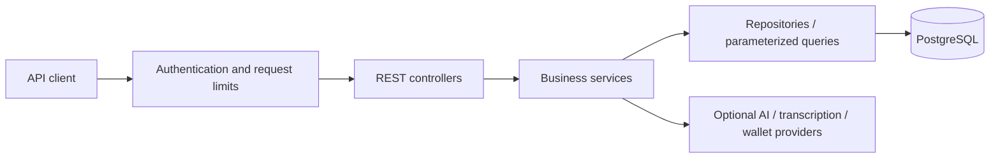

# Sana Backend

A Java 17 and Spring Boot 4 backend for managing a merchant's inventory, stock locations,
sales, invoices, customer payments, and operational history. Optional AI integrations
turn text or audio into inventory command cards that a user can review before executing.

This repository is a source-code showcase. It contains no customer database, production
credentials, or deployment infrastructure. A live demo is not hosted here.

## What it implements

- Inventory creation, stock additions, sales, transfers, updates, and soft deletion.
- Per-user locations, product suggestions, and short-term command-card memory.
- Immutable ADD/SELL invoice snapshots and invoice-based stock reversal.
- Customer assignment, payment recording, idempotency, payment reversals, and balance summaries.
- Paginated customer, invoice, and logbook APIs, plus fixed inventory and sales analytics queries.
- Email/phone registration, Argon2id password hashes, and opaque token authentication.
- Optional DeepSeek/OpenAI command parsing, ElevenLabs transcription and short-lived realtime tokens,
  and an authenticated WalletWallet pass proxy.

## Architecture



Controllers handle HTTP requests; services enforce ownership and business rules;
repositories own database access. Flyway migrations version the schema.
Transactions keep invoice, stock, and payment changes consistent.

## Local setup

Requirements: Java 17, PostgreSQL 16, and a shell. The Maven wrapper downloads Maven.
Docker is optional for development and required for PostgreSQL integration tests.

1. Create an empty local PostgreSQL database named `sana` and a local user with access to it.
2. Copy the environment example and replace the local database password:

   ```bash
   cp .env.example .env
   ```

3. Export the variables in your shell. For the local file you have just edited:

   ```bash
   set -a
   source .env
   set +a
   ./mvnw spring-boot:run
   ```

Spring Boot does not automatically load `.env`. Flyway initializes the new local database;
Hibernate validates the resulting schema. No API keys are required for the inventory,
customer, payment, logbook, or fixed analytics APIs. Leave optional provider keys blank
unless you intend to call those paid services; unconfigured integrations return `503`.

The backend listens on `http://localhost:8080`. Browser access from another origin requires
an explicit `CORS_ALLOWED_ORIGINS` value, such as `http://localhost:3000`.

## Synthetic API example

Register with a made-up address and a password chosen only for local testing:

```bash
curl -X POST http://localhost:8080/api/auth/register \
  -H 'Content-Type: application/json' \
  -d '{"identifier":"demo@example.test","password":"local-demo-password"}'
```

Set `SANA_TOKEN` locally to the returned token, then use it in the `token` request header:

```bash
curl http://localhost:8080/api/products -H "token: ${SANA_TOKEN}"

curl -X POST http://localhost:8080/api/locations \
  -H "token: ${SANA_TOKEN}" --data-urlencode 'name=Demo shop'

curl -X POST http://localhost:8080/api/inventory/command \
  -H "token: ${SANA_TOKEN}" -H 'Content-Type: application/json' \
  -d '{"operation":"CREATE","productName":"Demo notebook","location":"Demo shop","quantity":10,"originalPrice":25}'
```

Existing usernames and email/phone identifiers can log in through `/api/auth/login`.
Tokens expire after 24 hours; `/api/auth/logout` revokes them immediately. Tokens are not
accepted through cookies or query parameters.

API groups: `/api/products`, `/api/locations`, `/api/inventory`, `/api/customers`,
`/api/invoices`, `/api/logs`, `/api/analytics`, `/api/command`, `/api/ai`, and `/api/passes`.
See [customer payments](docs/customer-payments-api.md) and
[product suggestions](docs/product-autocomplete.md) for additional request contracts.

## Verification

```bash
./mvnw clean verify
python3 scripts/install-security-tools.py
.tools/gitleaks dir . --redact --no-banner
.tools/gitleaks git . --redact --no-banner --log-opts='--all'
./mvnw org.cyclonedx:cyclonedx-maven-plugin:2.9.1:makeAggregateBom -DoutputName=bom.cdx
.tools/osv-scanner scan source --lockfile=target/bom.cdx.json
```

The showcase uses the Spring Boot 4.0 maintenance line with explicit security patch overrides
for Tomcat and Jackson where newer fixes are not yet in the starter BOM.

The suite covers API contracts, tenant isolation, password hashing, input validation,
rate limits, financial operations, invoice reversal concurrency, and Flyway migrations.
When Docker is unavailable, PostgreSQL tests are skipped. CI requires those tests to run
and also checks secrets, dependencies, and Java code with CodeQL.

## Security decisions and limitations

- AI output is untrusted. Commands are validated before preprocessing and mutation.
  Model-generated SQL execution is removed; `GET` inventory commands return
  `400 UNSUPPORTED_OPERATION`. Use the structured product, logbook, and analytics APIs.
- ADD/SELL undo requires an owned active `invoiceId` and matching operation. The server
  uses stored stock deltas and ignores submitted item quantities. MOVE undo is unavailable.
- Wallet passes require authentication and a server-side provider key. CORS is closed
  unless explicit origins are configured. Provider redirects are not followed.
- Login is limited to 10 attempts per minute and registration to 5 attempts per hour per
  socket IP. Forwarded IP headers are ignored. AI and wallet calls have additional limits.
- JSON/text requests, uploads, and provider responses have size limits. Unexpected errors
  and provider failures do not return internal exception details.
- Sessions, rate limits, and command memory are held in one process. Sessions are lost on
  restart. Horizontal scaling requires shared state and an explicitly designed proxy policy.
- This showcase is not a production deployment prescription. A deployment needs HTTPS,
  appropriate database/network privileges, operational monitoring, and secret management.
- Security scans reduce known risks; they cannot establish that no vulnerabilities exist.

## License

[MIT](LICENSE). See [contributing](CONTRIBUTING.md) and [security reporting](SECURITY.md).
