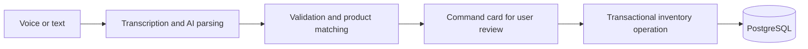

# Sana Backend

**The backend behind Sana, an AI-first app for merchants to manage inventory and sales through voice and text.**

[](https://github.com/stallbek/sana-backend/actions/workflows/ci.yml)
[](https://github.com/stallbek/sana-backend/actions/workflows/security.yml)

Built by [Stalbek](https://github.com/stallbek). Sana turns everyday merchant instructions into structured actions: adding stock, recording sales, moving products, and updating inventory. The backend connects AI interpretation with the transactions, invoices, and payment records that keep those operations consistent.

**Java 17 · Spring Boot 4 · PostgreSQL · Spring Data JPA · Flyway · JUnit · Testcontainers · GitHub Actions**

## AI-first workflow

A merchant can say or type an instruction such as **“Move 10 notebooks from the warehouse to the shop.”** Sana interprets the request, resolves product and location names, and returns a command card for review before execution.



DeepSeek/OpenAI handles command parsing; ElevenLabs handles speech transcription. Context from the merchant's inventory and short-term command memory supports follow-up edits. Model output passes through server-side validation and ownership checks before any mutation.

## What Sana handles

- **Inventory:** stock across locations, additions, sales, transfers, updates, and product suggestions.
- **Invoices:** saved transaction snapshots and reversal of stock additions and sales.
- **Customers and payments:** customer balances, payment history, retry protection, and payment reversals.
- **Reporting:** paginated activity history, inventory summaries, and sales trends.
- **Accounts:** email/phone registration, Argon2id password hashing, and expiring session tokens.

## Engineering highlights

| Problem | Implementation | Code |
| --- | --- | --- |
| Turning language into business actions | Context-aware parsing, product matching, and editable command cards | [AI pipeline](src/main/java/com/is/aigul/service/FullService.java) |
| Reversing a sale safely | Transactions and database locks; stock reversal uses stored invoice data | [Invoice service](src/main/java/com/is/aigul/service/InvoiceService.java) |
| Handling repeated payment requests | Idempotency keys and request fingerprints prevent duplicate entries and reject conflicting retries | [Payment service](src/main/java/com/is/aigul/service/CustomerPaymentService.java) |
| Protecting merchant data | Authentication by default, ownership checks, request limits, and validation of AI output | [Authentication](src/main/java/com/is/aigul/config/ApiAuthenticationFilter.java) · [Validation](src/main/java/com/is/aigul/service/CommandValidator.java) |
| Keeping reporting predictable | Parameterized SQL aggregations and paginated APIs | [Analytics queries](src/main/java/com/is/aigul/repository/AnalyticsQueryRepository.java) |

REST controllers handle HTTP, services own business rules, and repositories handle persistence. Flyway versions the schema.

## Verification

Tests cover API contracts, merchant data isolation, AI command processing, payment behavior, concurrent invoice reversal, and migrations. PostgreSQL integration tests use Testcontainers; CI requires the migration and undo tests to run. Automated security checks include Gitleaks, OSV-Scanner, and CodeQL.

```bash
./mvnw clean verify
```

Requires Java 17. Docker is needed for PostgreSQL integration tests; they are skipped locally when Docker is unavailable. Tests use isolated fixtures and mocked providers.

<details>
<summary><strong>Run locally</strong></summary>

Create an empty PostgreSQL 16 database named `sana` and a local database user. Then:

```bash
cp .env.example .env
# Set your local database credentials and AI provider keys in .env.
set -a
source .env
set +a
./mvnw spring-boot:run
```

The API runs at `http://localhost:8080`; Flyway initializes the database. Configure DeepSeek or OpenAI for text commands and ElevenLabs for voice input. Without provider keys, AI endpoints return `503`; the underlying inventory and ledger APIs remain available for local inspection.

API details: [customer payments](docs/customer-payments-api.md) · [product suggestions](docs/product-autocomplete.md).

</details>

This is a curated code showcase of the private Sana project, with a fresh Git history and no production credentials or customer data. Sessions, request limits, and command memory currently live in one process; horizontal scaling requires shared state.

[MIT License](LICENSE) · [Contributing](CONTRIBUTING.md) · [Security reporting](SECURITY.md)
